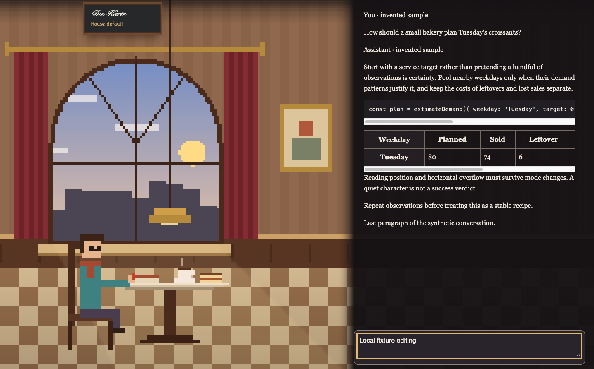
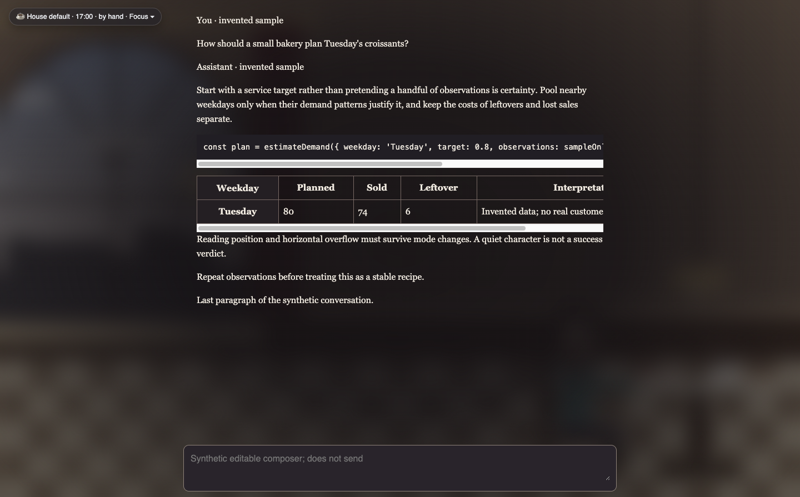

# Kaffeehaus for Hermes Desktop

A pixel café that lives behind your [Hermes Desktop](https://github.com/NousResearch/hermes-agent) chat and follows your local time. Morning light comes in through the window, dusk turns it orange, and at night the lamp comes on and the stars come out.

Choose between two seats:

- **Window Seat:** the room sits beside your chat, sharp and in full view.
- **Focus:** the chat is centred and the room is blurred behind it, so you get the atmosphere without the detail.

| Window Seat | Focus |
|---|---|
|  |  |

<sub>These screenshots come from the test harness, with an invented chat. They are not screenshots of Hermes Desktop.</sub>

## Install

You need Hermes Desktop 0.23.1 or newer, on macOS. Only macOS has been tested.

```sh
hermes plugins install Bonorinoa/hermes-kaffeehaus
```

If you'd rather install by hand, copy `desktop/plugin.js` into a new folder `~/.hermes/desktop-plugins/hermes-kaffeehaus/` (that file is all Desktop needs).

The plugin installs **switched off**. To start it:

1. In Hermes Desktop, open **Capabilities → Plugins** and turn **Kaffeehaus** on.
2. Open the **Kaffeehaus** tab in the sidebar and click **Apply to one chat**.

## Use it

- **The board and the pill:** in Window Seat a chalkboard, *Die Karte*, hangs on the café wall. In Focus a small glass pill sits in the corner. Click either one to change the seat, the hour, the look, or to pick a **house blend**: *Kleiner Schwarzer* (dark, reading first), *Melange* (balanced) or *Einspänner* (the room comes through). Press Esc to close.
- **The sidebar tab** has the same controls, plus reading width, motion, **Peek at room** and **Off / restore**.
- **Looks** are set per seat:

  | Slider | What it changes |
  |---|---|
  | Scene blur | How blurred the room is |
  | Scene brightness | How bright the room is |
  | Text panel opacity | How solid the panel behind the text is |
  | Glass blur | How frosted that panel is |

  When Window Seat has to put text over the room in a narrow window, it keeps a minimum blur and dimming so the text stays readable.
- **Reading width** is a maximum in Window Seat. The text narrows, but never below 360 px, so the room fits beside it.

## What it does and doesn't do

- It runs entirely on your machine. There are no network requests, nothing is stored, and there is no telemetry or location lookup. The hour comes from your Mac's clock, and the sun and moon follow illustrative paths, not real astronomy.
- It never reads your chats. The note-taker's poses are decorative and don't react to what you or the agent do.
- It respects your system's Reduce Motion setting, and you can turn motion off yourself.
- It works only with dark themes, including Glass. On light or unrecognised themes it refuses to start rather than make your text hard to read.
- Settings reset when the app reloads; nothing is saved yet.

## ⚠️ Experimental

The Hermes plugin SDK doesn't yet offer a way to restyle the chat area, so Kaffeehaus reaches into Desktop's internal layout (`data-slot` elements and CSS variables). A Hermes update can break it. If that happens, the plugin is built to turn itself off and restore the chat as it was. For the same reason, it doesn't meet the official plugin catalog's "SDK surface only" rule (`hermes plugins validate .` warns about this), so it's distributed from this repo until an SDK hook exists.

To uninstall: `hermes plugins remove hermes-kaffeehaus`, or delete `~/.hermes/desktop-plugins/hermes-kaffeehaus/`.

## Build on it

There are no dependencies; you only need Node 20 or newer.

```sh
node build.mjs            # src/ + art/ → desktop/plugin.js (one file; imports only the SDK and React)
node --test               # 28 unit tests: clock, layout, looks, package rules
```

| Path | What it is |
|---|---|
| `art/kaffeehaus.js` | The café, drawn in code: `Kaffeehaus.draw(ctx, width, hour, frame, {wx, tx, state})`, 144 px tall |
| `src/scene-time.mjs` | Local civil time → scene hour |
| `src/controller.mjs` | State: seat, width, clock, motion, looks, house blends |
| `src/layout.mjs` | Geometry for both seats |
| `src/scene.mjs` | Mounts the canvas, veil and glass behind the chat, and restores everything on Off |
| `src/overlay.mjs` | The menu board and the glass pill |
| `src/controls.mjs` | The sidebar tab |

Ideas that would fit: more rooms, more house blends, saving settings, light themes, and an official SDK hook so this can join the catalog. Issues and pull requests are welcome.

## Credits

Made by Augusto Gonzalez-Bonorino. Inspired by [Borealis](https://github.com/Adolanium/hermes-borealis) by Adolanium. MIT licensed; see `NOTICE.md`.
