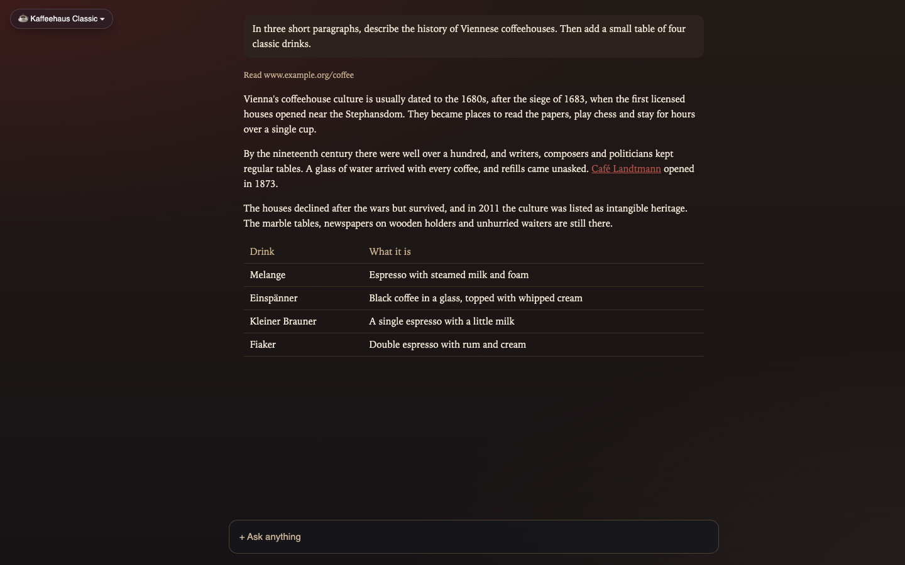
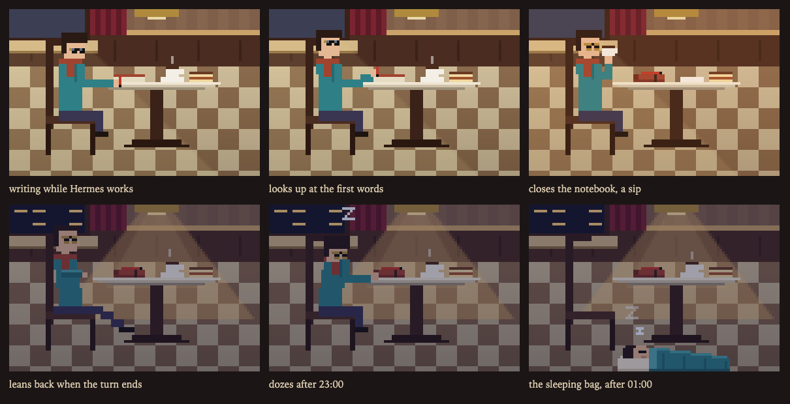
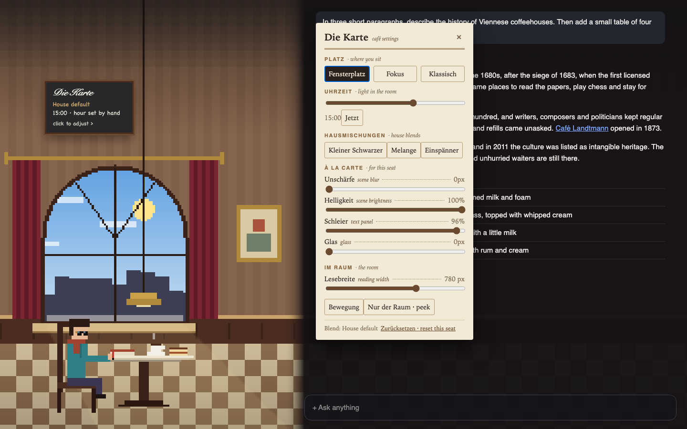

# Kaffeehaus for Hermes Desktop

A pixel café that lives behind your [Hermes Desktop](https://github.com/NousResearch/hermes-agent) chat and follows your local time. Morning light comes in through the window, dusk turns it orange, and at night the lamp comes on and the stars come out. Someone at the next table writes while Hermes works.

<!-- CLIP -->

It runs entirely on your Mac, never reads your chats, and switches itself off rather than get in your way. A personal side project; unofficial, not affiliated with Nous Research.

**Quick start** (macOS, Hermes Desktop 0.23.1+, a dark theme):

```sh
hermes plugins install Bonorinoa/hermes-kaffeehaus
```

Then turn **Kaffeehaus** on in **Capabilities → Plugins**, open a chat, press **⌘K** and run **Kaffeehaus café**.

Choose a seat:

- **Window Seat:** the room sits beside your chat, sharp and in full view.
- **Focus:** the chat is centred and the room is blurred behind it, so you get the atmosphere without the detail.
- **Classic:** no room. The Kaffeehaus palette and type (espresso, oxblood, cream, serif prose) over Hermes's normal layout.

| Window Seat | Focus | Classic |
|---|---|---|
|  |  |  |

<sub>These screenshots come from a test page with an invented chat, running the real plugin. They are not screenshots of Hermes Desktop.</sub>

## The note-taker

Someone sits at the café table with a notebook. They write while Hermes is working, look up when the first words of the answer arrive, then close the notebook and take a sip when the turn ends. Late at night they doze off, and after one in the morning they may get out a sleeping bag. People walk past the window during the day.



The note-taker only knows *whether* Hermes is working (two on/off signals from the plugin SDK, the same ones the status bar uses) and the time. It never sees what you or Hermes write.

## Install

You need Hermes Desktop 0.23.1 or newer, on macOS. Only macOS has been tested.

```sh
hermes plugins install Bonorinoa/hermes-kaffeehaus
```

If you'd rather install by hand, copy `desktop/plugin.js` into a new folder `~/.hermes/desktop-plugins/hermes-kaffeehaus/` (that file is all Desktop needs). To update: `hermes plugins update hermes-kaffeehaus`, then reload Hermes.

The plugin installs **switched off**. To start it:

1. In Hermes Desktop, open **Capabilities → Plugins** and turn **Kaffeehaus** on.
2. Open the chat you want, then open the **Kaffeehaus** tab in the sidebar and click **Open the café**. (Or press ⌘K and run **Kaffeehaus café**.)

You can close the tab afterwards; the café keeps running. ⌘K → **Kaffeehaus: show the tab** brings it back.

## Use it

Everything is changed from inside the café:

- **Window Seat:** click the chalkboard on the wall, *Die Karte*. The menu opens over the chat, so the window stays in view while you change the hour.
- **Focus and Classic:** click the ☕ pill in the top-left corner.



The card has the seat, the hour (or *Jetzt* to follow the clock), three **house blends** (*Kleiner Schwarzer*: dark, reading first; *Melange*: balanced; *Einspänner*: the room comes through), the look sliders for this seat, the reading width, motion, and **Peek** (the room on its own; Esc to come back). Tab moves through the card and Esc closes it.

| Slider | What it changes |
|---|---|
| Scene blur | How blurred the room is |
| Scene brightness | How bright the room is |
| Text panel | How solid the panel behind the text is |
| Glass | How frosted that panel is |

When Window Seat has to put text over the room in a narrow window, it keeps a minimum blur and dimming so the text stays readable. Reading width is a maximum in Window Seat: the text narrows, but never below 360 px, so the room fits beside it.

Switching seats eases the chat into place and fades the room across. With macOS **Reduce motion** on, everything switches instantly and the note-taker holds still.

## What it does and doesn't do

- It runs entirely on your machine. There are no network requests, nothing is stored, and there is no telemetry or location lookup. The hour comes from your Mac's clock, and the sun and moon follow illustrative paths, not real astronomy.
- It never reads your chats. The note-taker reacts only to whether Hermes is working, not to what anyone wrote.
- Motion is on by default. It respects your system's Reduce motion setting, and you can turn motion off on the card.
- It works only with dark themes, including Glass. On light or unrecognised themes it refuses to start rather than make your text hard to read.
- It changes one chat at a time, in the main window. Split panes, pop-out and HUD windows stay as they are.
- Settings are kept while the app runs (Off and back on returns to the same café) and reset when it reloads; nothing is saved to disk.

## If something looks wrong

| What you see | Why, and what to do |
|---|---|
| The café switched itself off | You opened a different chat in that window, changed to a light theme, or Hermes changed its layout. Open the chat you want and run ⌘K → **Kaffeehaus café** again. |
| "Not applied" | It needs exactly one chat on screen and a dark theme. Close split panes and try again. |
| The tab is gone | You closed it, which is fine. ⌘K → **Kaffeehaus: show the tab** brings it back. |
| Nothing moves | macOS **Reduce motion** is on (System Settings → Accessibility → Display), or Motion is off on the card. |
| The menu covers my text | That's on purpose while it's open, so the window stays visible. Esc closes it. |

Found a bug or have an idea? [Open an issue](https://github.com/Bonorinoa/hermes-kaffeehaus/issues).

## ⚠️ Experimental

The Hermes plugin SDK doesn't yet offer a way to restyle the chat area, so Kaffeehaus reaches into Desktop's internal layout (`data-slot` elements and CSS variables). A Hermes update can break it. If that happens, the plugin is built to turn itself off and restore the chat as it was. For the same reason, it doesn't meet the official plugin catalog's "SDK surface only" rule (`hermes plugins validate .` warns about this), so it's distributed from this repo until an SDK hook exists.

To uninstall: `hermes plugins remove hermes-kaffeehaus`, or delete `~/.hermes/desktop-plugins/hermes-kaffeehaus/`.

## Build on it

There are no dependencies; you only need Node 20 or newer.

```sh
node build.mjs            # src/ + art/ → desktop/plugin.js (one file; imports only the SDK and React)
node --test               # unit tests: clock, layout, looks, character, art, package rules
tools/fixture/shoot.sh window "seat=window&hour=10&open=1"   # screenshot the real bundle on a stand-in chat page (needs Chrome)
```

| Path | What it is |
|---|---|
| `art/kaffeehaus.js` | The café and the note-taker, drawn in code: `Kaffeehaus.draw(ctx, width, hour, frame, {wx, tx, state, since})`, 144 px tall |
| `src/character.mjs` | The note-taker's states: writing, looking up, wrap-up, doze, sleeping bag |
| `src/scene-time.mjs` | Local civil time → scene hour |
| `src/controller.mjs` | State: seat, width, clock, motion, looks, house blends |
| `src/layout.mjs` | Geometry for the seats |
| `src/scene.mjs` | Mounts the canvas, veil and glass behind the chat, and restores everything on Off |
| `src/overlay.mjs` | The menu board, the glass pill and the card they open |
| `src/controls.mjs` | The plugin session and the sidebar launcher |

Ideas that would fit: more rooms, more house blends, more people in the room, saving settings, light themes, and an official SDK hook so this can join the catalog. Issues and pull requests are welcome.

## Credits

Made by Augusto Gonzalez-Bonorino. Inspired by [Borealis](https://github.com/Adolanium/hermes-borealis) by Adolanium. MIT licensed; see `NOTICE.md`.
